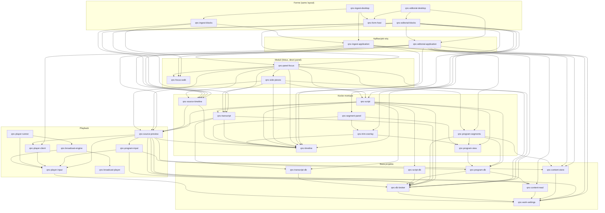
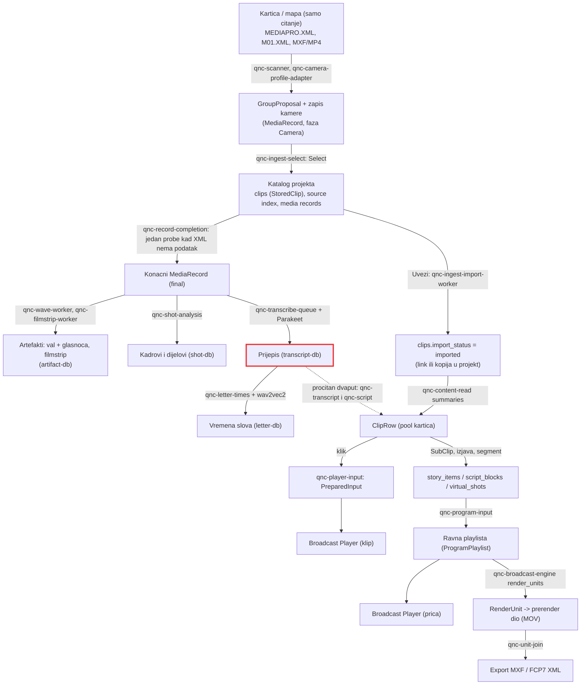

# QNC arhitektura - stvarno stanje iz koda

Stanje: 2026-11-06, grana `libav-decoder`, commit `ad9f6919`. Sve brojke i veze izvucene su
alatima iz koda (ne pretpostavljene). Kako se dokument osvjezava: odjeljak 8.

## 1. Velicina

| | broj |
|---|---|
| paketa u workspaceu | 312 (9 aplikacija, 19 alata, 284 kocke u `crates/`) |
| redaka Rusta (`src/`) | ~157 000 |
| kockice koje nitko ne koristi | `qnc-editorial-shell`, `qnc-source-input` (`qnc-media-readahead` koristi se samo uz znacajku `libav`) |
| kruzne ovisnosti crateova | nema (Cargo ih ne dopusta) |

Najkoristenije kocke (koliko drugih paketa ovisi o njima): `qnc-ui-text` 112,
`qnc-dev-diagnostics` 63, `qnc-db-broker` 38, `qnc-media-metadata` 37, `qnc-contracts` 36,
`qnc-work-settings` 31, `qnc-ui-kit` 28, `qnc-desktop-theme` 27, `qnc-timeline` 22,
`qnc-content-store` 22.

Najvece kocke (redaka) i broj nasih ovisnosti:

| kocka | redaka | ovisnosti |
|---|---|---|
| qnc-program-db | 6825 | 4 |
| qnc-broadcast-engine | 5929 | 13 |
| qnc-program-segments | 5753 | 23 |
| qnc-broadcast-player | 4227 | 1 |
| qnc-project-store | 3385 | 6 |
| qnc-timeline | 3301 | 13 |
| qnc-script | 3195 | **35** |
| qnc-content-store | 3098 | 9 |
| qnc-program-playlist | 2451 | 2 |
| qnc-ingest-application | 2441 | **34** |
| qnc-ingest-select | 2415 | 26 |

Kocke s najvise ovisnosti (kandidati za monolit, pravilo 0.11): `qnc-script` 35,
`qnc-ingest-application` 34, `qnc-editorial-application` 32, `qnc-panel-focus` 32,
`qnc-source-preview` 27, `qnc-ingest-select` 26, `qnc-program-segments` 23,
`qnc-source-timeline` 22.

## 2. Dijagram kocki i ovisnosti (srediste aplikacije)

Samo stvarne veze iz `cargo metadata` medu 35 sredisnjih kocki. Strelica znaci "ovisi o".



Jednom recenicom:

- **qnc-editorial-desktop / qnc-ingest-desktop**: prozor forme; predaje aplikaciju domacinu forme.
- **qnc-editorial-blocks / qnc-ingest-blocks**: ploca; smjesta panele na mjesta iz ugovora rasporeda.
- **qnc-form-host**: jedna petlja forme (poll, tipke kao akcije kataloga, ritam crtanja).
- **qnc-editorial-application / qnc-ingest-application**: aplikacijski sloj; povezuje projekt, preview, pool i fokus.
- **qnc-panel-focus**: prima svaku sistemsku radnju i predaje je kocki panela u fokusu (Story, MA, S-Story).
- **qnc-focus-walk**: krug panela (Tab, Enter, redovi i popisi); dijele ga Ingest i Story.
- **qnc-side-pieces**: pravi samo dijelove desnog panela koje raspored ima (prijepis, kadrovi, scenarij).
- **qnc-script**: scenarij, snimanje glasa, slozena izjava, uredivanje teksta izjave.
- **qnc-transcript**: prijepis prikazanog klipa i red prijepisa.
- **qnc-program-segments**: upravljac price (Wrap, markeri, slotovi, pokrivalice, zoom, Sync).
- **qnc-program-view**: prikaz price iz zapisa baze, bez stanja.
- **qnc-source-timeline**: jedini source timeline (A1/A2, IN/OUT, tipke).
- **qnc-timeline**: crtanje i mapa misa svakog timelinea.
- **qnc-segment-panel / qnc-trim-overlay**: panel Segmenti i zoom reza (pasivni).
- **qnc-source-preview**: jedini preview: klip, prica ili slozena izjava kroz isti player.
- **qnc-player-client / runner / broadcast-engine / broadcast-player**: klijent, proces, engine i transport playera.
- **qnc-player-input / qnc-program-input**: ulaz playera iz baze (klip, odnosno prica).
- **qnc-db-broker**: posrednik baze projekta; serijski pisac; moduli tablica posjeduju svoje tablice.
- **qnc-content-store / content-read**: katalog klipova (jedini pisac i citac).
- **qnc-program-db / script-db / transcript-db**: tablice price, scenarija i prijepisa.
- **qnc-work-settings**: postavke aktivnog projekta, samo citanje.

Nalazi u grafu:

- `qnc-script` ovisi o playeru (`qnc-source-preview`), o bazi price (`qnc-program-db`) i o
  prijepisu (`qnc-transcript` i `qnc-transcript-db`). To su cetiri odgovornosti u jednoj kocki
  (`lib.rs` 1946 redaka).
- **`qnc-script` i `qnc-transcript` obje citaju prijepise iz baze**, svaka svojim citanjem i
  svojom memorijom. Takav dvostruki put dao je danasnju gresku (prazan prijepis u MA Scriptu).
- `qnc-program-view` (prikaz bez stanja) ovisi o `qnc-program-db` (vlasnik tablica): kocka
  prikaza povlaci modul baze samo zbog tipova zapisa.
- `qnc-panel-focus` ima 32 ovisnosti: osim usmjeravanja zna i za scenarij, prijepis, pricu i
  preview. To je sredisnji kontroler (pravilo 0.11 ga zabranjuje pod drugim imenom).
- Ingest i Story/MA dijele krug fokusa (`qnc-focus-walk`), source timeline i preview, ali
  imaju dva aplikacijska sloja (`qnc-ingest-application` 2441 redak, `qnc-editorial-application`
  731 redak) s istim obrascem (projekt, pool, preview, poster).

## 3. Put jednog klipa kroz sustav

Tip podatka mijenja se na svakoj strelici. Crveno je mjesto gdje se isti posao radi dvaput.



Gdje se posao radi dvaput:

1. **Citanje prijepisa**: `qnc-transcript` (panel prijepisa) i `qnc-script` (rijeci izjave)
   citaju iste retke iz `transcript-db` svaki za sebe i drze ih u svojoj memoriji.
2. **Citanje kartice nakon Selecta**: dovrsetak zapisa (probe), val i filmstrip, analiza
   kadrova i red prijepisa citaju isti original jedan za drugim. Jedan prolaz vala i filmstripa
   postojao je (16. 10.), a 18. 10. vracen je na dva prolaza zbog brzine prikaza.
3. **Dva aplikacijska sloja** (Ingest, Story/MA) ponavljaju ucitavanje projekta, poola,
   postera i spajanje previewa (sad vecinom kroz zajednicke kocke, ali svaki ima svoj
   `lib.rs` od 500 do 2400 redaka).
4. **Zoom reza** se gradi u dva vlasnika (`qnc-program-segments` za pricu,
   `qnc-script` za slozenu izjavu) nad istom kockom prikaza. To je namjerno (vlasnik daje os),
   ali svaki vlasnik ima svoje stanje uzetog (`Take`, `Trim`, `JoinSound`), a tu nastaju razlike
   koje korisnik vidi kao "u zoomu radi drukcije".

## 4. Jedan ciklus forme i playera

Sto se dogada u jednom crtanju forme dok player stoji ili svira:

```mermaid
sequenceDiagram
  participant UI as Nit sucelja (form-host)
  participant APP as editorial-application
  participant PRE as source-preview
  participant PCL as player-client nit
  participant RUN as qnc-player-runner (proces)
  participant BG as pozadinske niti kocki
  participant DB as project.db (posrednik)

  UI->>APP: poll()
  APP->>PRE: poll()
  PRE->>PCL: take state (bez cekanja)
  PCL-->>RUN: upit stanja / naredba (socket, mali paketi)
  RUN-->>PCL: stanje; slika ide kroz frame-map (mmap)
  APP->>BG: side-pieces poll: prijepis, scenarij, kadrovi
  BG->>DB: citanje u svojoj niti (katalog 2 s, prijepis 1 s, scenarij 2 s, red 1 s)
  DB-->>BG: retci
  BG-->>APP: preuzeto bez cekanja (mpsc try_recv)
  APP->>APP: view.clone() pa usporedba (je li se nesto promijenilo)
  UI->>UI: crtanje ploce (paneli, timeline, zoom)
  UI->>APP: radnja (tipka, mis) -> panel-focus route
  APP->>BG: upis kroz posrednika (bez cekanja)
  BG->>DB: transakcija, korak undoa
```

Gdje se blokira ili nepotrebno kopira (iz loga i koda):

- **Nit sucelja ne ceka bazu** u ovim kockama: svako citanje i upis ide kroz pozadinsku nit.
  Log `ui-block-ms` u mirovanju MA Scripta pokazuje `desktop-update` 6-108 ms, najvise u
  `form-paint` i `form-poll`. Crtanje je mjesto koje kosta, ne baza.
- **Kopija cijelog prikaza u svakom pollu**: `Transcript::poll` i druge kocke rade
  `let before = self.view.clone()` pa usporeduju. Veliki dijelovi su `Arc`, pa je kopija jeftina,
  ali usporedba je na svakom crtanju.
- **`.clone()` najvise**: `qnc-program-segments` 196, `qnc-broadcast-engine` 121,
  `qnc-program-db` 105, `qnc-script` 68, `qnc-ingest-select` 68.
- **`Arc<Mutex>`** ima malo: `qnc-program-output-host` 4, `qnc-trim-stills` 3,
  `qnc-player-client` 3, ostali 1-2. To nije problem.
- **Memorija kao istina**: kocke koje drze procitano iz baze i ponovno citaju samo na
  dogadaj su bile izvor gresaka (prijepis u MA Scriptu, oznaka uvoza u poolu 29. 10.). Ispravno je
  ono sto danas radi `qnc-transcript`: ponovno citanje u ritmu, usporedba sadrzaja.

## 5. Revizija skretanja (prioritet)

### P1 - krsi pravila iz AGENTS.md ili vec daje greske

1. **Dvostruko citanje iste tablice u dvije kocke** (`qnc-transcript` i `qnc-script` za
   prijepise). Jedna kocka treba citati prijepise klipa i davati ih obama. Danasnja greska je
   bila iz ove klase.
2. **`qnc-script` je postao monolit**: 35 ovisnosti, 1946 redaka u `lib.rs`, unutra je
   scenarij, snimanje, slozena izjava (rubovi, rez, J/L, pomak dijela, zoom), uredivanje teksta,
   slova i export. Pravilo 0.11: jedna kocka, jedna odgovornost. Prirodna podjela je slozena
   izjava (`qnc-subsegment-edit`, vec jednom postojala 31. 10. pa vracena), uredivanje teksta
   izjave i scenarij.
3. **`qnc-panel-focus` zna previse** (32 ovisnosti): uz usmjeravanje radnji drzi i pravila
   price, Synca, shuttlea, trima i match framea. Prema 0.11 trebao bi samo predavati radnju kocki
   panela.
4. **Memorija kao istina u drugim kockama**: pregledati sve `Option<(uri, clip, data)>`
   predmemorije koje se citaju samo na promjenu klipa (posteri, zvuk klipa, kadrovi, kanali) i
   dati im isti obrazac kao prijepisu (ponovno citanje u ritmu, usporedba).

### P2 - visak koda

5. **Neiskoristene ovisnosti** (`cargo machete`, 40 paketa). Najvise: `qnc-editorial-application`
   (4), `qnc-editorial-layout` (4), `qnc-ingest-application` (4), `qnc-ingest-store` (4),
   `qnc-source-preview` (4), `qnc-ingest-import-worker` (3), `qnc-player-runner` (3).
   Napomena: conformance trazi da manifest i kod budu uskladeni, pa ih treba maknuti, ne ignorirati.
6. **Kocke koje nitko ne koristi**: `qnc-editorial-shell`, `qnc-source-input`.
7. **Traitovi s jednom implementacijom** (provjeriti trebaju li za testove ili granicu):
   `ClipInputs`, `DecoderJobs`, `FilmstripContentRead/Write/WriteFactory`,
   `WaveContentRead/Write/WriteFactory`, `FrameBlocks`, `MonotonicScheduler`, `PictureSource`.
   Filmstrip i val imaju po tri zrcalna traita; jedan par citac/pisac artefakata bio bi dovoljan.
8. **Prosljedivaci**: `qnc-ingest-store::content` (samo re-export `qnc-content-store`),
   `qnc-wheel-jog` (ponovno izvozi postavku iz `qnc-edit-step`), `qnc-right-panel` (ponovno izvozi
   konstante `qnc-side-pieces`).

### P3 - kvaliteta koda (clippy pedantic, 4446 upozorenja)

9. Pretvorbe brojeva bez provjere: ~900 (`u64 as f64`, `as u32`, `as i64`). Za frameove i
   uzorke to je stvarni rizik na dugim klipovima i satnim snimkama; vrijedi kocka s
   provjerenim pretvorbama za vrijeme (frame, uzorak, sekunda).
10. Funkcije dulje od 100 redaka: 61.
11. Argumenti preneseni po vrijednosti a ne potroseni: 87; implicitne kopije (`to_string` na
    `&String`, `clone` na referenci): 60.
12. Ostalo je dokumentacija i `#[must_use]` (~1900); ne vrijedi rada sada.

## 6. Smjer: gdje se arhitektura udaljila od AGENTS.md

| pravilo | stanje u kodu |
|---|---|
| 0.1 baza je jedina veza | Uglavnom postuje se. Izuzetak su predmemorije kocki citane samo na dogadaj (P1-4). |
| 0.11 forma samo layout, kocka jedna odgovornost | Forme su tanke (ploce 93-155 redaka). Odgovornost se skupila u `qnc-script`, `qnc-panel-focus`, `qnc-program-segments`. |
| 0.12 timeline i zoom isti alati | Rjecnik radnji (`qnc-edit-verbs`), pravila ruba i reza (`qnc-edit-edge`, `qnc-edit-cut`) su zajednicki; stanje uzetog i dalje je dvaput (prica, slozena izjava). |
| 2 nema monolita | Tri kandidata iznad. |
| 4 jedan pisac po bazi | Postuje se kroz posrednika i module tablica. |

Sto bih pojednostavio prvo (redom):

1. **Jedna kocka citanja prijepisa** (P1-1). Mala, uklanja klasu greske koja se upravo dogodila.
2. **Izdvojiti slozenu izjavu iz `qnc-script`** u svoju kocku (P1-2). Najveci dobitak za
   stabilnost, jer se tu najvise mijenjalo zadnjih dana.
3. **`qnc-panel-focus` svesti na usmjeravanje** (P1-3): pravila price u `qnc-program-segments`,
   Sync u `qnc-sync-session`, shuttle i trim u svoje kocke (vec postoje), fokus ih samo poziva.
4. **Ocistiti ovisnosti** (P2-5, P2-6): mehanicki posao, manja gradnja.
5. Tek onda nove mogucnosti iz `docs/98-missing-tools-plan.md`.

## 7. Sirovi rezultati alata (za usporedbu poslije)

- `cargo machete`: 40 paketa s neiskoristenim ovisnostima (popis u P2-5 i u izlazu alata).
- `cargo clippy --workspace -- -W dead_code -W clippy::pedantic`: 4446 upozorenja; mrtvog koda
  gotovo nema (jedna dodjela u `tools/qnc-ingest-worker/src/main.rs:159` koja se nikad ne cita).
- `cargo modules structure` (verzija 0.26; 0.28 trazi rustc 1.98):
  - `qnc-program-segments`: 19 modula (commands, confirm, create, cut_part, delete, edit,
    marker_edit, nav, part_sound, refresh, select, slip, slot_move, slot_trim, story_read, sync,
    undo_selected, writes, zoom);
  - `qnc-script`: 5 modula (pointer, read, text_edit, view, word_pick), ostatak u `lib.rs`;
  - `qnc-panel-focus`: 4 modula (panel, route, trim, walk).

## 8. Kako osvjeziti ovaj dokument

```bash
cargo metadata --format-version 1 --no-deps > meta.json
cargo machete
cargo clippy --workspace --message-format=short -- -W dead_code -W clippy::pedantic
cargo modules structure --package qnc-script --lib --no-fns --no-types --no-traits
```

Nakon vece promjene: ponovno izracunati tablice 1, dijagram 2 i popis 5, i u novom odjeljku
zapisati razliku prema ovom stanju.
